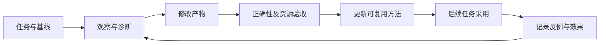

# 模型推理评测 RSI

从模型推理与评测任务中持续改进代码、配置、诊断工具、验收方法和 Skill，并用后续任务验证这些改进。首版为 `0.1.0`，以 ProteinArena 的 C550 pLDDT、CPU IPR 和标准 Design 评测为案例。

人的入口是本文，agent 使用 [SKILL.md](SKILL.md)。[案例索引](cases/)记录改进的来由、采用情况和反例。[离线评测](evaluations/README.md)检查证据与结论，并定义下一轮方法效果的比较方式。

## 改进怎样闭环



每个改进记录都有触发问题、已有证据、变更产物、验证、适用条件、后续采用和未解决项。修改采样器、保护计时或评分分母，都会改变后续工作的可靠性，需要像 kernel 优化一样进入改进链。

## 首版内容

| 案例 | 可迁移的方法 | 已知边界 |
| --- | --- | --- |
| [pLDDT / C550](cases/plddt-c550/README.md) | profiler 定位、算子与整模型消融、多卡分片、逐候选误差 | 单算子收益随硬件变化，汇总接近时仍有离群值 |
| [IPR trace 与调度](cases/ipr-trace-and-scheduling/README.md) | 提交到完成的时序、native 线程归因、依赖约束下的调度 | 分块与原全库有已知计分 ID 差异 |
| [恢复与保护控制器](cases/protection-controller/README.md) | 持久交接、运维线索、阶段计时、历史日志回放 | 错峰第二波仍超时，全量并跑尚未通过 |
| [标准 Design](cases/design-standardization/README.md) | 冻结输入、槽位映射、候选权重、独立复测 | 空哨兵需明确处理，Easy 有旧实现越界 |

方法按问题查阅 [GPU 性能](references/gpu-performance.md)、[CPU 诊断](references/cpu-diagnosis.md)、[账户与故障恢复](references/recovery.md)、[项目进度交接](references/project-progress.md)、[评测正确性](references/evaluation-correctness.md)。C550、8×8、5 秒阈值属于案例环境中的实测选择，新任务依据自身资源和用户约定确定参数。

## 目录与使用

```text
model-inference-eval-rsi/
├── README.md
├── SKILL.md
├── references/
├── cases/                  案例说明与带父节点的改进记录
├── evaluations/            小型汇总证据、离线任务与判定标准
└── scripts/                本地只读证据检查
```

在本目录运行下面的命令检查改进链、证据摘要及断言。检查使用随仓库携带的小型汇总快照，Python 标准库即可运行。

```bash
python3 scripts/check_repository.py
```

位于 ProteinArena 工作区时，可进一步检查证据来源文件的哈希与摘录值。工作区路径显式传入，适用于从其他目录调用。

```bash
python3 scripts/check_repository.py --project-root ../..
```

这些检查通过表示已归档证据与本仓库的断言一致。原实验执行和独立验收由源报告记录。Skill 对下一次 agent 任务的收益仍待按 [评测协议](evaluations/README.md) 测量。

首版 [检查记录](evaluations/repository-check.json) 覆盖 4 个案例、10 个节点、12 份证据摘要和 33 项断言。[校验器回归](evaluations/checker-regression.json) 验证了隔离副本可运行，以及证据篡改、依赖成环、错误成功断言和原始来源变化能被检出。

## 当前版本和后续迭代

首版记录见 [registry.json](registry.json)，改进节点在各案例的 `case.json` 中。节点保留历史顺序，`parents` 表示这项改进使用了哪些先前产物或反馈。补入证据、规则或工具变更后，运行已有检查并记录产物版本及适用范围。发现反例时补入反例与适用边界，需要回退的采用策略在新节点中说明。

第一轮方法效果评测先用 [tasks.json](evaluations/tasks.json) 的开发任务与 [rubric.json](evaluations/rubric.json) 检查诊断、验收和恢复判断。它们来自已沉淀案例。后续迁移评测另外冻结未用于编写 Skill 的输入，预期答案由评审保管，记录同一任务预算下的基线与本版本表现。

仓库包含运行离线检查所需的小型证据快照。案例中的 ProteinArena 外部相对链接和原始实验路径指向源归档；在 GitHub 上阅读时可先查看 [证据索引](evaluations/evidence.json)。持有原始实验归档时，使用显式 `--project-root` 进行来源校验。

## 阅读与网页呈现

建议按 GPU 优化、CPU 性能、故障与保护、标准评测顺序读案例。后续网页以同一份案例 JSON 生成优化历程、改进关系图和验证面板，展示配置、样本规模、收益、数值差异及失败状态，每项能回查证据。现有项目页面的结构与恢复入口记录在 ProteinArena 工作区的 `agent-progress/websites.md` 中。
