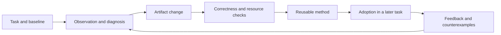

# Model Inference and Evaluation RSI

Improve the artifacts that an agent uses to run, diagnose, and validate inference and evaluation workloads. This repository connects observations to changes in kernels, scheduling, instrumentation, recovery procedures, acceptance checks, and reusable instructions.

The initial `0.1.0` baseline uses the ProteinArena evaluation project as its first case study. The methods target broader inference and evaluation work across hardware and workload types.

Start with [SKILL.md](SKILL.md) to use the methods in an agent task. Read the [case studies](cases/) to inspect their evidence and limits.

## The improvement loop



An improvement record identifies the triggering problem, the observed evidence, the artifact changed, the validation performed, and later adoption. Rejected changes and partial results remain in the history because they constrain future decisions.

## Case studies

| Case | Method developed | Current limit |
| --- | --- | --- |
| [pLDDT on C550](cases/plddt-c550/README.md) | Profile the actual model, measure complete workloads, balance devices, inspect numerical tails | Kernel gains depend on hardware and accepted numerical tolerance |
| [IPR tracing and scheduling](cases/ipr-trace-and-scheduling/README.md) | Separate queue delay, native execution, and thread creation | Partitioned searches retain known differences from the original full-library configuration |
| [Recovery and protection](cases/protection-controller/README.md) | Preserve state, use operator incident evidence, replay protection events | A later staggered wave still exceeded its launch limit |
| [Design evaluation integrity](cases/design-standardization/README.md) | Freeze inputs, restore candidate weights, verify slots and metric definitions | Empty sentinels and legacy metric behavior require explicit treatment |

For a current task, choose [GPU performance](references/gpu-performance.md), [CPU diagnosis](references/cpu-diagnosis.md), [recovery](references/recovery.md), [project progress](references/project-progress.md), or [evaluation correctness](references/evaluation-correctness.md). Hardware names, concurrency values, and thresholds in a case describe that experiment's operating conditions.

## Run the offline checks

```bash
python3 scripts/check_repository.py
```

The checker uses the Python standard library and bundled evidence snapshots. It validates the improvement graph, evidence fingerprints, links, and assertions about archived results. With the original ProteinArena archive available, also verify the source files.

```bash
python3 scripts/check_repository.py --project-root /path/to/ProteinArena
```

[Check results](evaluations/repository-check.json) record the verification scope. [Checker regressions](evaluations/checker-regression.json) cover an isolated copy, altered evidence, a lineage cycle, a false success claim, and a changed source file.

## Repository layout

```text
model-inference-eval-rsi/
├── SKILL.md
├── references/       Methods selected by the current problem
├── cases/            Narratives and linked improvement records
├── evaluations/      Evidence snapshots, checks, tasks, and rubrics
└── scripts/          Offline verification
```

[registry.json](registry.json) identifies the initial version. Each case contains a `case.json`. Its `parents` edges record dependencies between improvements. Add feedback and applicability limits when a later task adopts or rejects a method.

The source archive contains the original experiment outputs and execution records. The bundled evidence contains selected numerical fields and an incident log line with source paths, source hashes, and field pointers. These observations can be checked against the source archive without rewriting its records.

## What has been evaluated

Archived-evidence checks have been run. A controlled comparison of agent performance with and without these methods remains pending, as does a held-out transfer evaluation. The [evaluation protocol](evaluations/README.md) defines how to measure those outcomes. The six development tasks are derived from the cases already represented in this repository.

The next presentation layer can render the same case records as a chronological view, an improvement graph, and a validation dashboard. Each displayed claim should retain its workload identity, measurement scope, and evidence link.

The [progress procedure](references/project-progress.md) explains how a consuming project maintains durable direction records and active task handoffs. [Account recovery](references/recovery.md) covers the user's private credential backup and authentication recovery.
